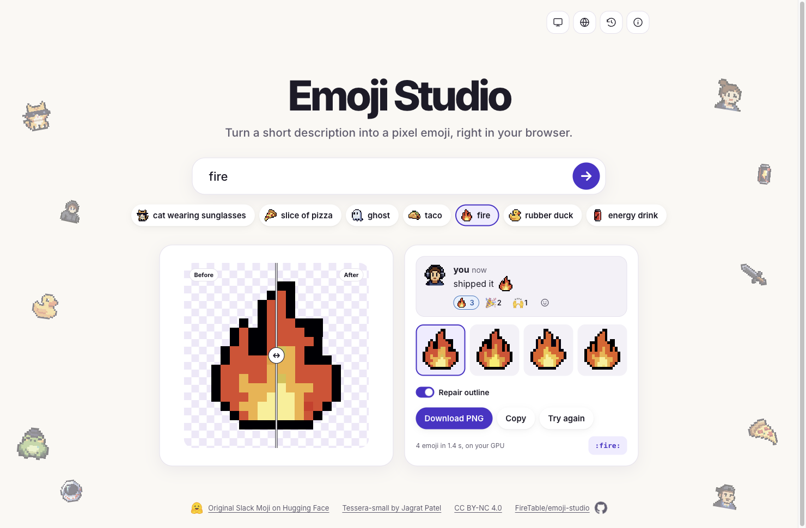

<h1 align="center">Emoji Studio</h1>

<p align="center"><b>输入一句描述，在自己的浏览器里生成像素表情。</b></p>
<p align="center"><a href="https://emoji.firetable.tech"><b>在线体验</b></a> · <a href="README.md">English</a> · 简体中文</p>

Emoji Studio 是 FireTable 基于 [Slack Moji](https://huggingface.co/spaces/cfahlgren1/slack-moji) 做的非商业改版。输入文字后，Tessera-small 会生成四张 16×16 表情。可以预览聊天效果、复制图片或导出 PNG，也可以打开描边修复，拖动滑块对比前后效果。

## 截图



[移动端深色模式](screenshots/mobile.png)

## 工作方式

- **端侧出图**。浏览器的 Web Worker 通过 ONNX Runtime Web 跑 Tessera 和 CLIP。优先使用设备的 GPU，WebGPU 不可用时切换到本机 CPU。输入和生成结果都在浏览器内处理。
- **并行下载**。两个 INT8 ONNX 权重约 115 MB，拆成八个最大 16 MiB 的分片，最多同时下四个。浏览器按偏移拼回模型，检查分片长度后写入缓存。浏览器清理缓存或存储空间不足时，可能重新下载。
- **修复描边**。开关默认关闭。打开后，外露的彩色边缘会补一格深色像素，保留原有像素和封闭的透明孔。预览、复制与导出都会应用当前设置。

- **IndexedDB 历史**。生成完成后，提示词和结果保存在当前浏览器。在历史抽屉中展开一条记录，可以独立预览、复制或导出。
- **显示设置**。中英文共用同一套推理与历史。主题支持跟随系统、浅色、深色，会在绘制页面前生效。
- **加载恢复**。如果上次初始化中断，同一标签页再次打开时会自动尝试单片下载和 CPU 推理。

## 本地开发

```sh
git clone https://github.com/FireTable/emoji-studio.git
cd emoji-studio
npm ci
npm run dev
```

`npm run check` 检查 Svelte，`npm run build` 生成 `build/`，`npm run preview` 预览构建结果。测试本机 CPU 路径时，可在网址后加 `?cpu`。

## 部署

将 `build/` 放到支持 HTTPS 的静态站点。线上版使用 Cloudflare Pages 托管页面，通过 FireTable CDN 分发模型。下载地址和分片大小在 [src/lib/client.js](src/lib/client.js) 中配置。自行镜像权重时，见 [英文部署说明](README.md#deployment)。

中英文页面在构建时预渲染成 HTML。网页头部和 HTTP `Link` 响应头都指向对应语言的 Markdown 介绍和 [`llms.txt` 索引](https://emoji.firetable.tech/llms.txt)。Cloudflare Pages 的响应头配置见 [static/_headers](static/_headers)。

## 鸣谢

- **Caleb Fahlgren** 制作了 [Slack Moji](https://huggingface.co/spaces/cfahlgren1/slack-moji)，导出了 ONNX 模型，并移植了前端采样代码。
- **Jagrat Patel（TheJagStudio）** 设计并训练了 [Tessera-small](https://huggingface.co/thejagstudio/tessera-small)。
- **Angais** 发布了 Tessera 使用的训练集 [Pixel Art Atlas 1.4M](https://huggingface.co/datasets/Angais/pixel-art-atlas-1.4m)。
- **OpenAI** 发布了 [CLIP ViT-B/32](https://huggingface.co/openai/clip-vit-base-patch32) 文本编码器。**ONNX Runtime Web** 提供了 [浏览器推理运行时](https://onnxruntime.ai/docs/tutorials/web/)。

FireTable 修改了页面样式，加入描边修复、历史和双语外观设置，并在 Cloudflare 上实现了并行下载与缓存。

## 许可

应用改版和 Tessera 权重沿用 [CC BY-NC 4.0](LICENSE)。CLIP 使用 [MIT](https://github.com/openai/CLIP/blob/main/LICENSE)。商业授权见 [Tessera 模型卡](https://huggingface.co/thejagstudio/tessera-small#license)。
