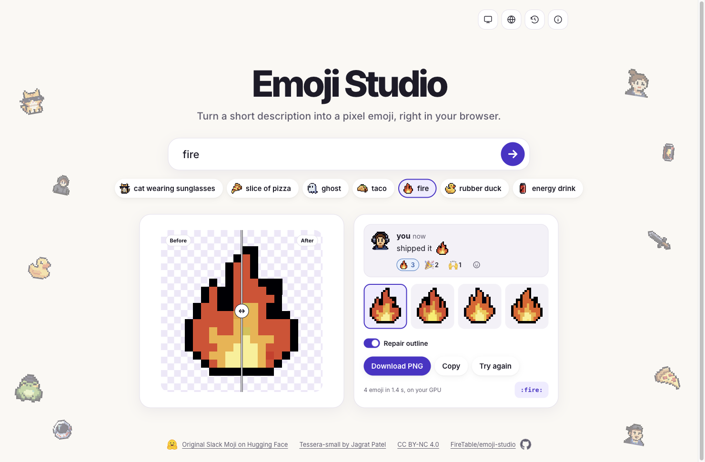

<h1 align="center">Emoji Studio</h1>

<p align="center"><b>Describe a pixel emoji and make it on your own device.</b></p>
<p align="center"><a href="https://emoji.firetable.tech"><b>Live demo</b></a> · English · <a href="README-CN.md">简体中文</a></p>

Emoji Studio is FireTable's non-commercial adaptation of [Slack Moji](https://huggingface.co/spaces/cfahlgren1/slack-moji). It runs Tessera-small in a browser and makes four 16×16 sprites from a short prompt. The page includes a chat preview, PNG export, clipboard copy, an optional outline repair with a before-and-after slider, and browser-local history.

## Screenshots



[Mobile preview in dark mode](screenshots/mobile.png)

## How it works

- **Local inference.** A Web Worker runs the Tessera denoiser and CLIP text encoder using ONNX Runtime Web. It tries WebGPU and falls back to the device's CPU via WebAssembly. The worker receives the prompt and returns pixels within the browser.
- **Model downloads.** The two upstream INT8 ONNX files total about 115 MB. They are served as eight versioned binary parts (up to 16 MiB each), with up to four requests in flight. The browser writes each part into the corresponding offset and checks its size before it enters Cache Storage. Storage limits or eviction can trigger a fresh download.
- **Outline repair.** The optional switch adds dark pixels where colored edges meet the outside background. It keeps the original pixels and enclosed transparent holes intact. The preview, copying, and PNG export all use the selected appearance.

- **IndexedDB history.** Completed generations and their prompts are saved in the current browser. Expand an entry in the history drawer to preview, copy, or export it while keeping the current workspace.
- **Display settings.** English and 简体中文 share the same worker and history. System, light, and dark appearances apply before the first paint.
- **Load recovery.** After an interrupted start, the next visit in the same tab tries one download at a time and runs inference on the CPU.

## Quickstart

```sh
git clone https://github.com/FireTable/emoji-studio.git
cd emoji-studio
npm ci
npm run dev
```

Use `npm run check` for the Svelte checks, `npm run build` to build the static site, and `npm run preview` to serve that build locally. Add `?cpu` to the page URL to try the CPU path.

## Deployment

Serve `build/` from an HTTPS static host. The live site uses Cloudflare Pages for the UI and FireTable's CDN for the large model files. The download location and part size are set in [src/lib/client.js](src/lib/client.js). The tokenizer, palette, and self-test fixture ship with the page. The worker fetches a pinned ONNX Runtime Web release from jsDelivr.

To mirror the models, use the ONNX files from [upstream revision `8e8aecc`](https://huggingface.co/spaces/cfahlgren1/slack-moji/tree/8e8aecc55e855a51bb952c892efbef647c0ce372/static/models). Split each in order into 16 MiB pieces named `tessera_w8.1.bin` through `tessera_w8.4.bin` and `clip_text_w8.1.bin` through `clip_text_w8.4.bin`. Set `MODEL_URL` to the directory holding the files. If serving them from another origin, allow the site to fetch them with CORS. Change the cache name when changing the model release.

Both language routes are prerendered as HTML. The HTML head and HTTP `Link` headers point to the corresponding Markdown overview and the [`llms.txt` index](https://emoji.firetable.tech/llms.txt). Cloudflare Pages serves the Markdown response headers from [static/_headers](static/_headers).

## Acknowledgements

- **Caleb Fahlgren** created [Slack Moji](https://huggingface.co/spaces/cfahlgren1/slack-moji), exported the ONNX models, and ported the sampler to JavaScript.
- **Jagrat Patel (TheJagStudio)** created and trained [Tessera-small](https://huggingface.co/thejagstudio/tessera-small).
- **Angais** released [Pixel Art Atlas 1.4M](https://huggingface.co/datasets/Angais/pixel-art-atlas-1.4m), the dataset used to train Tessera.
- **OpenAI** released the [CLIP ViT-B/32](https://huggingface.co/openai/clip-vit-base-patch32) text encoder. **ONNX Runtime Web** provides the [browser runtime](https://onnxruntime.ai/docs/tutorials/web/).

FireTable adapted the interface, added outline repair, added the browser-local history and localized display settings, and changed distribution to concurrent, cached downloads from Cloudflare.

## License

The adaptation follows [CC BY-NC 4.0](LICENSE) for the original app and Tessera weights. CLIP is under [MIT](https://github.com/openai/CLIP/blob/main/LICENSE). See the [Tessera model card](https://huggingface.co/thejagstudio/tessera-small#license) for commercial licensing.
